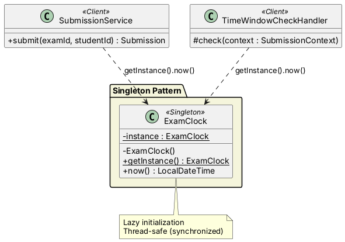
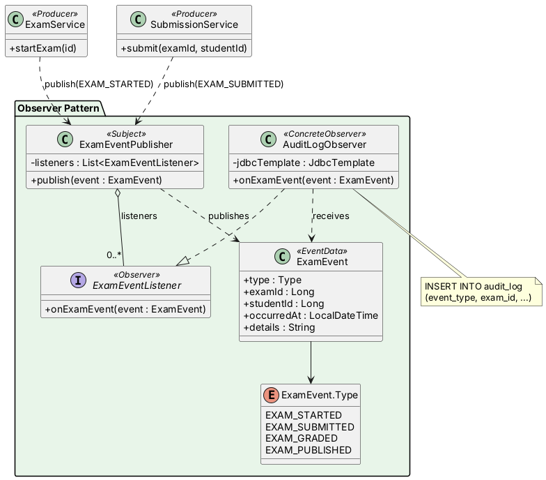
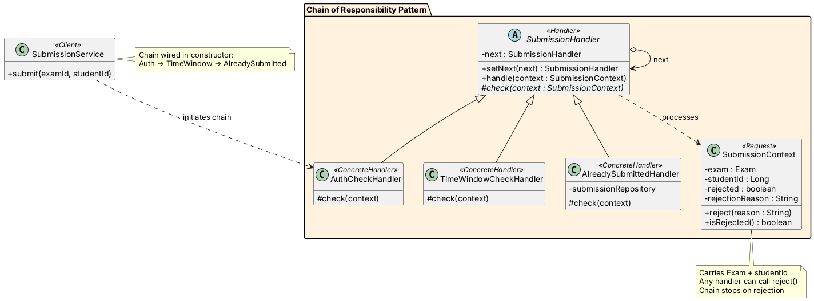
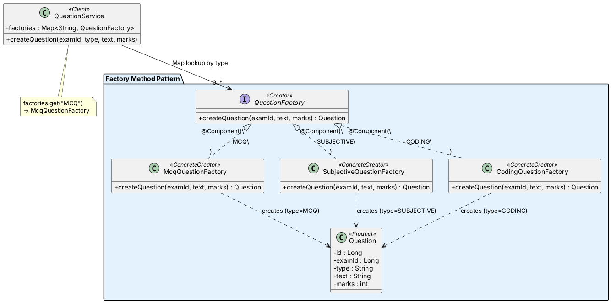
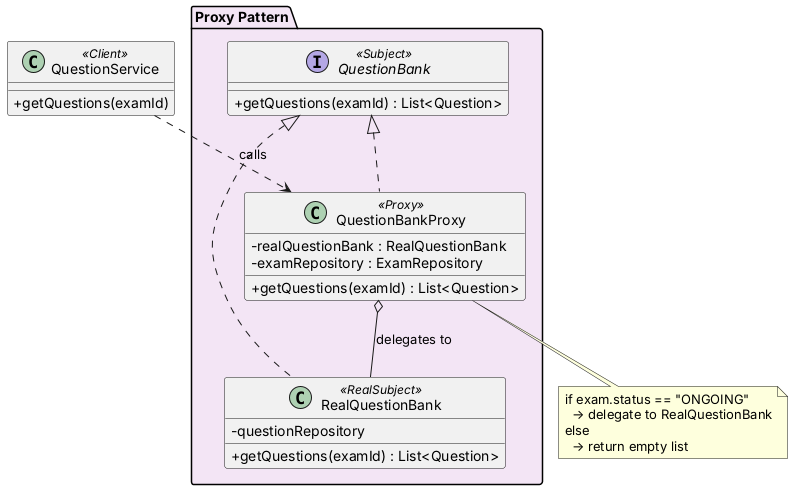
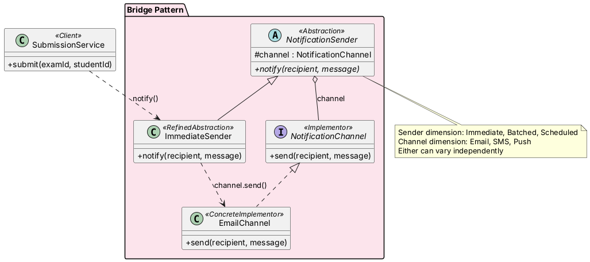

# EOMS — Design Patterns UML Context

> Focused on the **6 GoF Design Patterns** used in the project.
> All class names and relationships are from the actual codebase.
> PlantUML code — paste into [plantuml.com](https://www.plantuml.com/plantuml/uml/) to render.

---

## Pattern 1 — Singleton (Creational)

### Identified In
`ExamClock` — single time-source instance for the entire application.

### Classes Involved

| Class | Role in Pattern |
|---|---|
| `ExamClock` | **Singleton** — private constructor, static `getInstance()`, lazy init with `synchronized` |
| `SubmissionService` | Client — calls `ExamClock.getInstance().now()` for timestamps |
| `TimeWindowCheckHandler` | Client — calls `ExamClock.getInstance().now()` for time validation |

### How They Interact
`SubmissionService` and `TimeWindowCheckHandler` both call `ExamClock.getInstance()` to get the single shared clock. No direct instantiation — always through the static factory method. Thread-safe via `synchronized`.

### PlantUML

---

## Pattern 2 — Observer (Behavioral)

### Identified In
Exam event system — decouples lifecycle events (exam started, submission recorded) from handlers (audit logging).

### Classes Involved

| Class | Role in Pattern |
|---|---|
| `ExamEventPublisher` | **Subject** — maintains list of listeners, calls `onExamEvent()` on each |
| `ExamEventListener` | **Observer** (interface) — defines `onExamEvent(ExamEvent)` |
| `AuditLogObserver` | **ConcreteObserver** — writes event data to `audit_log` table via `JdbcTemplate` |
| `ExamEvent` | **Event Data** — carries type, examId, studentId, timestamp, details |
| `ExamService` | Event Producer — publishes `EXAM_STARTED` |
| `SubmissionService` | Event Producer — publishes `EXAM_SUBMITTED` |

### How They Interact
`ExamService` and `SubmissionService` create an `ExamEvent` and call `ExamEventPublisher.publish()`. The publisher iterates over all `ExamEventListener` beans (auto-collected by Spring DI as `List<ExamEventListener>`) and calls `onExamEvent()` on each. `AuditLogObserver` receives the event and writes an audit row to the database.

### PlantUML

---

## Pattern 3 — Chain of Responsibility (Behavioral)

### Identified In
Submission validation — a chain of 3 handlers validates a submission request sequentially. Any handler can reject.

### Classes Involved

| Class | Role in Pattern |
|---|---|
| `SubmissionHandler` | **Handler** (abstract) — holds `next` reference, template `handle()` calls `check()` then delegates |
| `AuthCheckHandler` | **ConcreteHandler 1** — verifies exam status is `ONGOING` |
| `TimeWindowCheckHandler` | **ConcreteHandler 2** — verifies current time is within exam window (uses `ExamClock`) |
| `AlreadySubmittedHandler` | **ConcreteHandler 3** — checks if student already submitted (queries DB) |
| `SubmissionContext` | **Request Object** — carries `Exam`, `studentId`, rejection state |
| `SubmissionService` | Client — builds chain, initiates `handle()` |

### How They Interact
`SubmissionService` constructor wires the chain: `AuthCheck → TimeWindow → AlreadySubmitted`. On `submit()`, it creates a `SubmissionContext` and calls `authCheckHandler.handle(context)`. Each handler runs its `check()` — if it doesn't reject, it passes to `next.handle()`. If any handler calls `context.reject(reason)`, the chain stops and `SubmissionService` throws an exception.

### PlantUML

---

## Pattern 4 — Factory Method (Creational)

### Identified In
Question creation — different question types (`MCQ`, `SUBJECTIVE`, `CODING`) are created by their respective factory, looked up by type string.

### Classes Involved

| Class | Role in Pattern |
|---|---|
| `QuestionFactory` | **Creator** (interface) — defines `createQuestion(examId, text, marks)` |
| `McqQuestionFactory` | **ConcreteCreator** — creates `Question` with `type="MCQ"` |
| `SubjectiveQuestionFactory` | **ConcreteCreator** — creates `Question` with `type="SUBJECTIVE"` |
| `CodingQuestionFactory` | **ConcreteCreator** — creates `Question` with `type="CODING"` |
| `Question` | **Product** — the entity created by the factories |
| `QuestionService` | Client — holds `Map<String, QuestionFactory>`, looks up by type |

### How They Interact
Spring auto-collects all `QuestionFactory` beans into a `Map<String, QuestionFactory>` using their `@Component` names (`"MCQ"`, `"SUBJECTIVE"`, `"CODING"`) as keys. `QuestionService.createQuestion()` receives a type string, looks up the matching factory from the map, and calls `factory.createQuestion()`. The factory returns a `Question` entity with the correct type pre-set.

### PlantUML

---

## Pattern 5 — Proxy (Structural)

### Identified In
Question bank access control — questions are only returned when the exam is `ONGOING`. The proxy gates access before delegating to the real implementation.

### Classes Involved

| Class | Role in Pattern |
|---|---|
| `QuestionBank` | **Subject** (interface) — defines `getQuestions(examId)` |
| `RealQuestionBank` | **RealSubject** — fetches questions from `QuestionRepository` |
| `QuestionBankProxy` | **Proxy** — checks exam status; delegates to `RealQuestionBank` only if `ONGOING` |
| `QuestionService` | Client — calls proxy, unaware of the guard logic |

### How They Interact
`QuestionService` holds a `QuestionBankProxy` (injected by Spring). When `getQuestions()` is called, the proxy fetches the `Exam` from `ExamRepository` and checks its status. If `status == "ONGOING"`, it delegates to `RealQuestionBank.getQuestions()`. Otherwise, it returns an empty list — no DB query for questions at all.

### PlantUML

---

## Pattern 6 — Bridge (Structural)

### Identified In
Notification system — the sending strategy (immediate, batched) and delivery channel (email, SMS) can vary independently.

### Classes Involved

| Class | Role in Pattern |
|---|---|
| `NotificationSender` | **Abstraction** (abstract class) — holds a `NotificationChannel` reference |
| `ImmediateSender` | **RefinedAbstraction** — sends immediately through the channel |
| `NotificationChannel` | **Implementor** (interface) — defines `send(recipient, message)` |
| `EmailChannel` | **ConcreteImplementor** — prints `[EMAIL to ...]` (simulated send) |
| `SubmissionService` | Client — calls `notificationSender.notify()` after submission |

### How They Interact
`ImmediateSender` extends `NotificationSender` and inherits the `channel` field (a `NotificationChannel`). When `notify()` is called, `ImmediateSender` delegates to `channel.send()`. Currently `EmailChannel` is the only concrete channel. The bridge allows swapping sender strategy OR channel independently — e.g., add `BatchedSender` without touching channels, or add `SmsChannel` without touching senders.

### PlantUML

---

## Combined Overview — All 6 Patterns in Context

This shows how the patterns connect through the service layer — **not a full system diagram**, just the pattern wiring points.

```plantuml
@startuml Combined_PatternOverview
skinparam classAttributeIconSize 0
skinparam shadowing false
skinparam defaultFontName Inter
skinparam packageStyle rectangle

title "EOMS — Design Pattern Integration Overview"

package "Service Layer (Orchestration)" #ECEFF1 {
    class ExamService {
        + startExam(id)
    }
    class QuestionService {
        + createQuestion(examId, type, text, marks)
        + getQuestions(examId)
    }
    class SubmissionService {
        + submit(examId, studentId)
    }
}

package "①  Singleton" #F5F5DC {
    class ExamClock <<Singleton>> {
        + {static} getInstance() : ExamClock
        + now() : LocalDateTime
    }
}

package "②  Observer" #E8F5E9 {
    class ExamEventPublisher <<Subject>>
    interface ExamEventListener <<Observer>>
    class AuditLogObserver <<ConcreteObserver>>

    ExamEventPublisher o-- ExamEventListener
    AuditLogObserver ..|> ExamEventListener
}

package "③  Chain of Responsibility" #FFF3E0 {
    abstract class SubmissionHandler <<Handler>>
    class AuthCheckHandler
    class TimeWindowCheckHandler
    class AlreadySubmittedHandler

    SubmissionHandler <|-- AuthCheckHandler
    SubmissionHandler <|-- TimeWindowCheckHandler
    SubmissionHandler <|-- AlreadySubmittedHandler
    AuthCheckHandler --> TimeWindowCheckHandler : "next"
    TimeWindowCheckHandler --> AlreadySubmittedHandler : "next"
}

package "④  Factory Method" #E3F2FD {
    interface QuestionFactory <<Creator>>
    class McqQuestionFactory
    class SubjectiveQuestionFactory
    class CodingQuestionFactory

    QuestionFactory <|.. McqQuestionFactory
    QuestionFactory <|.. SubjectiveQuestionFactory
    QuestionFactory <|.. CodingQuestionFactory
}

package "⑤  Proxy" #F3E5F5 {
    interface QuestionBank <<Subject>>
    class QuestionBankProxy <<Proxy>>
    class RealQuestionBank <<RealSubject>>

    QuestionBank <|.. QuestionBankProxy
    QuestionBank <|.. RealQuestionBank
    QuestionBankProxy o-- RealQuestionBank
}

package "⑥  Bridge" #FCE4EC {
    abstract class NotificationSender <<Abstraction>>
    class ImmediateSender <<RefinedAbstraction>>
    interface NotificationChannel <<Implementor>>
    class EmailChannel <<ConcreteImplementor>>

    NotificationSender <|-- ImmediateSender
    NotificationSender o-- NotificationChannel
    NotificationChannel <|.. EmailChannel
}

' --- Wiring ---
ExamService ..> ExamEventPublisher : "②"
ExamService ..> ExamClock : "①"

QuestionService ..> QuestionFactory : "④"
QuestionService ..> QuestionBankProxy : "⑤"

SubmissionService ..> AuthCheckHandler : "③ initiates chain"
SubmissionService ..> ExamEventPublisher : "②"
SubmissionService ..> ImmediateSender : "⑥"
SubmissionService ..> ExamClock : "①"

TimeWindowCheckHandler ..> ExamClock : "①"
@enduml
```

---

## How to Render

Paste any of the `@startuml ... @enduml` blocks into:

| Tool | URL |
|---|---|
| **PlantUML Online** | [plantuml.com/plantuml/uml](https://www.plantuml.com/plantuml/uml/) |
| **PlantText** | [planttext.com](https://www.planttext.com/) |
| **VS Code** | Extension: `jebbs.plantuml` |
| **IntelliJ** | Built-in PlantUML plugin |

Each diagram renders independently — paste one at a time to get clean, focused images for your report or presentation.
