# EOMS — Online Examination Management System

> **Historical reference (Spring backend, no longer runnable here).** The current
> migration lives at the repository root; see [README](../../README.md) for the
> vanilla Java direction. The REST/Maven setup and diagrams below document the
> former implementation, not instructions for the new application. In particular,
> schema initialization is now manual, never automatic.

> **Full Name**: YDVRC — "Your Digital Venue for Rigorous Certification"
> **Artifact ID**: `com.eoms:eoms:0.0.1-SNAPSHOT`
> **Academic Context**: Semester 5, Design Patterns Lab Project (5–6 month scope)

---

## 1. Project Overview

EOMS is a **Spring Boot 3.3.4** backend application (Java 17) for managing online examinations. It exposes a REST API for creating exams, adding questions, and processing student submissions. The system is designed as a **Design Patterns showcase** — six GoF patterns are wired end-to-end into real business flows, not stubbed.

A lightweight **Swing/AWT desktop client** (planned) will consume these REST endpoints, split by user role (Student vs. Teacher).

| Concern        | Technology                         |
| -------------- | ---------------------------------- |
| Framework      | Spring Boot 3.3.4 (Spring Web, Spring JDBC) |
| Language       | Java 17                           |
| Database       | PostgreSQL 16 (`eoms_db`)          |
| ORM/Data       | `JdbcTemplate` (no JPA/Hibernate)  |
| Build Tool     | Apache Maven                       |
| Frontend       | Swing/AWT (planned, `java.net.http.HttpClient`) |
| Server Port    | 8080                               |

---

## 2. Directory Structure (Complete File Tree)

```
exam_system/
├── README.md
├── hehe.txt                          # Context notes
└── eoms/                             # Maven project root
    ├── pom.xml
    └── src/main/
        ├── resources/
        │   ├── application.properties
        │   └── schema.sql
        └── java/com/eoms/
            ├── EomsApplication.java           # @SpringBootApplication entry point
            │
            ├── config/                        # Reserved for bean overrides
            │   └── .gitkeep
            │
            ├── entity/                        # POJOs — no JPA annotations
            │   ├── Exam.java
            │   ├── Question.java
            │   ├── Student.java
            │   └── Submission.java
            │
            ├── repository/                    # JdbcTemplate-based DAOs
            │   ├── ExamRepository.java
            │   ├── QuestionRepository.java
            │   └── SubmissionRepository.java
            │
            ├── service/                       # Business logic, pattern orchestration
            │   ├── ExamService.java
            │   ├── QuestionService.java
            │   └── SubmissionService.java
            │
            ├── controller/                    # REST endpoints
            │   ├── ExamController.java
            │   ├── QuestionController.java
            │   └── SubmissionController.java
            │
            ├── exception/
            │   └── GlobalExceptionHandler.java  # @ControllerAdvice
            │
            └── patterns/                      # ★ Design Patterns — 6 packages
                ├── singleton/
                │   └── ExamClock.java
                ├── observer/
                │   ├── ExamEvent.java
                │   ├── ExamEventListener.java        # interface
                │   ├── ExamEventPublisher.java        # Subject
                │   └── AuditLogObserver.java          # ConcreteObserver
                ├── chainofresponsibility/
                │   ├── SubmissionHandler.java          # abstract base
                │   ├── SubmissionContext.java           # request object
                │   ├── AuthCheckHandler.java            # link 1
                │   ├── TimeWindowCheckHandler.java      # link 2
                │   └── AlreadySubmittedHandler.java     # link 3
                ├── factory/
                │   ├── QuestionFactory.java             # interface
                │   └── impl/
                │       ├── McqQuestionFactory.java      # @Component("MCQ")
                │       ├── SubjectiveQuestionFactory.java # @Component("SUBJECTIVE")
                │       └── CodingQuestionFactory.java   # @Component("CODING")
                ├── proxy/
                │   ├── QuestionBank.java                # interface (Subject)
                │   ├── RealQuestionBank.java            # RealSubject
                │   └── QuestionBankProxy.java           # Proxy
                └── bridge/
                    ├── NotificationSender.java          # Abstraction (abstract class)
                    ├── ImmediateSender.java             # RefinedAbstraction
                    └── channel/
                        ├── NotificationChannel.java     # Implementor (interface)
                        └── EmailChannel.java            # ConcreteImplementor
```

**Total: ~34 source files** (excluding `target/`, `.gitkeep`, resources)

---

## 3. Database Schema (5 Tables)

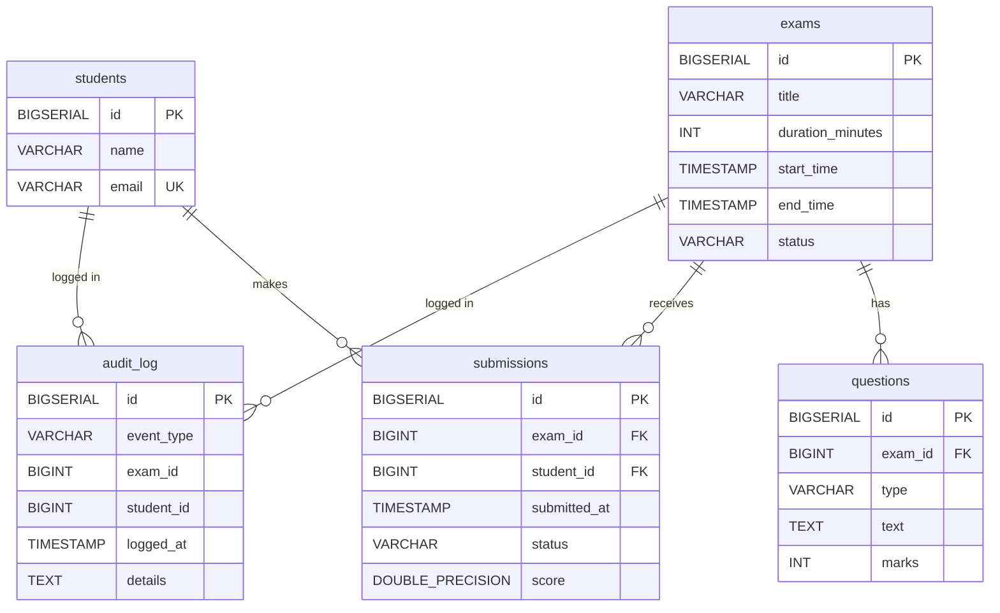

### Exam Status Lifecycle
`DRAFT` → `ONGOING` → (implicitly `ENDED` — not yet coded)

### Table Purposes
| Table         | Purpose                                                |
| ------------- | ------------------------------------------------------ |
| `students`    | Student identity (name, email)                         |
| `exams`       | Exam metadata & lifecycle status                       |
| `questions`   | Questions belonging to an exam, typed (MCQ/SUBJECTIVE/CODING) |
| `submissions` | Student exam submissions with timestamp & score        |
| `audit_log`   | Observer-written audit trail for all exam events       |

---

## 4. Entity Classes

### 4.1 `Exam`
| Field             | Type              | Notes                                      |
| ----------------- | ----------------- | ------------------------------------------ |
| `id`              | `Long`            | Auto-generated (BIGSERIAL)                 |
| `title`           | `String`          |                                            |
| `durationMinutes` | `int`             |                                            |
| `startTime`       | `LocalDateTime`   |                                            |
| `endTime`         | `LocalDateTime`   |                                            |
| `status`          | `String`          | `DRAFT`, `ONGOING`                         |

### 4.2 `Question`
| Field    | Type     | Notes                                    |
| -------- | -------- | ---------------------------------------- |
| `id`     | `Long`   | Auto-generated                           |
| `examId` | `Long`   | FK → `exams.id`                          |
| `type`   | `String` | `MCQ`, `SUBJECTIVE`, `CODING`            |
| `text`   | `String` |                                          |
| `marks`  | `int`    |                                          |

### 4.3 `Student`
| Field   | Type     | Notes              |
| ------- | -------- | ------------------ |
| `id`    | `Long`   | Auto-generated     |
| `name`  | `String` |                    |
| `email` | `String` | UNIQUE constraint  |

### 4.4 `Submission`
| Field         | Type              | Notes                    |
| ------------- | ----------------- | ------------------------ |
| `id`          | `Long`            | Auto-generated           |
| `examId`      | `Long`            | FK → `exams.id`          |
| `studentId`   | `Long`            | FK → `students.id`       |
| `submittedAt` | `LocalDateTime`   | Set via `ExamClock`      |
| `status`      | `String`          | `SUBMITTED`              |
| `score`       | `Double`          | Nullable                 |

---

## 5. REST API Endpoints

| Method | Path                              | Controller                | Description                       |
| ------ | --------------------------------- | ------------------------- | --------------------------------- |
| POST   | `/api/exams`                      | `ExamController`          | Create a new exam (status=DRAFT)  |
| GET    | `/api/exams`                      | `ExamController`          | List all exams                    |
| GET    | `/api/exams/{id}`                 | `ExamController`          | Get exam by ID                    |
| POST   | `/api/exams/{id}/start`           | `ExamController`          | Start exam (DRAFT→ONGOING) ★Observer fires |
| POST   | `/api/exams/{examId}/questions`   | `QuestionController`      | Add question ★Factory fires       |
| GET    | `/api/exams/{examId}/questions`   | `QuestionController`      | Get questions ★Proxy fires        |
| POST   | `/api/exams/{examId}/submissions` | `SubmissionController`    | Submit exam ★COR+Observer+Bridge fire |

---

## 6. Layered Architecture

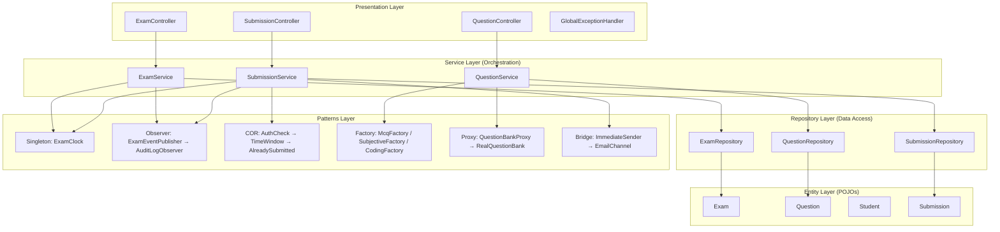

---

## 7. Design Patterns — Detailed Breakdown

### 7.1 Singleton — `ExamClock`

> **GoF Category**: Creational
> **Intent**: Ensure a single time-source instance across the application.

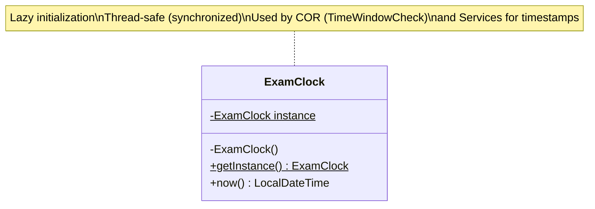

**Participants**:
| Role       | Class        |
| ---------- | ------------ |
| Singleton  | `ExamClock`  |

**Where Used**: `SubmissionService.submit()` (timestamps), `TimeWindowCheckHandler.check()` (current-time comparison)

---

### 7.2 Observer — Exam Event System

> **GoF Category**: Behavioral
> **Intent**: Decouple exam lifecycle events from their handlers (audit logging, future: notifications, analytics).

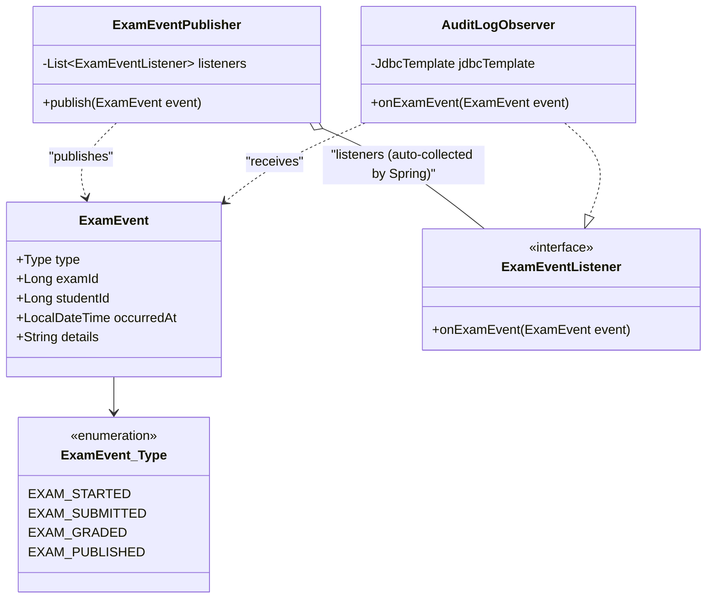

**Participants**:
| Role               | Class                |
| ------------------- | -------------------- |
| Subject             | `ExamEventPublisher` |
| Observer (interface)| `ExamEventListener`  |
| ConcreteObserver    | `AuditLogObserver`   |
| Event Data          | `ExamEvent`          |

**Where Used**: `ExamService.startExam()` publishes `EXAM_STARTED`; `SubmissionService.submit()` publishes `EXAM_SUBMITTED`.

---

### 7.3 Chain of Responsibility — Submission Validation

> **GoF Category**: Behavioral
> **Intent**: Process submission validation through a chain of independent checks; any link can reject.

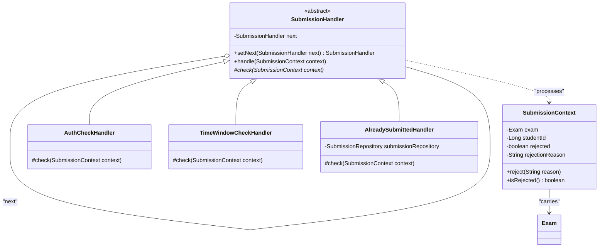

**Chain Order** (wired in `SubmissionService` constructor):
```
AuthCheckHandler → TimeWindowCheckHandler → AlreadySubmittedHandler
```

**Participants**:
| Role              | Class                      |
| ----------------- | -------------------------- |
| Handler (abstract)| `SubmissionHandler`        |
| ConcreteHandler 1 | `AuthCheckHandler`         |
| ConcreteHandler 2 | `TimeWindowCheckHandler`   |
| ConcreteHandler 3 | `AlreadySubmittedHandler`  |
| Request Object    | `SubmissionContext`        |

**Where Used**: `SubmissionService.submit()` — called before persisting any submission.

---

### 7.4 Factory Method — Question Creation

> **GoF Category**: Creational
> **Intent**: Create different question types (`MCQ`, `SUBJECTIVE`, `CODING`) without exposing instantiation logic.

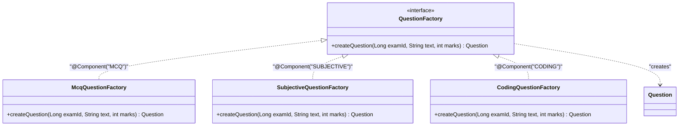

**Participants**:
| Role              | Class                       |
| ----------------- | --------------------------- |
| Creator (interface)| `QuestionFactory`          |
| ConcreteCreator 1 | `McqQuestionFactory`        |
| ConcreteCreator 2 | `SubjectiveQuestionFactory` |
| ConcreteCreator 3 | `CodingQuestionFactory`     |
| Product           | `Question`                  |

**Spring Wiring**: Named beans auto-collected into `Map<String, QuestionFactory>` — looked up by type string in `QuestionService`.

**Where Used**: `QuestionService.createQuestion()`.

---

### 7.5 Proxy — Question Bank Access Control

> **GoF Category**: Structural
> **Intent**: Gate access to questions — only return them when the exam status is `ONGOING`.

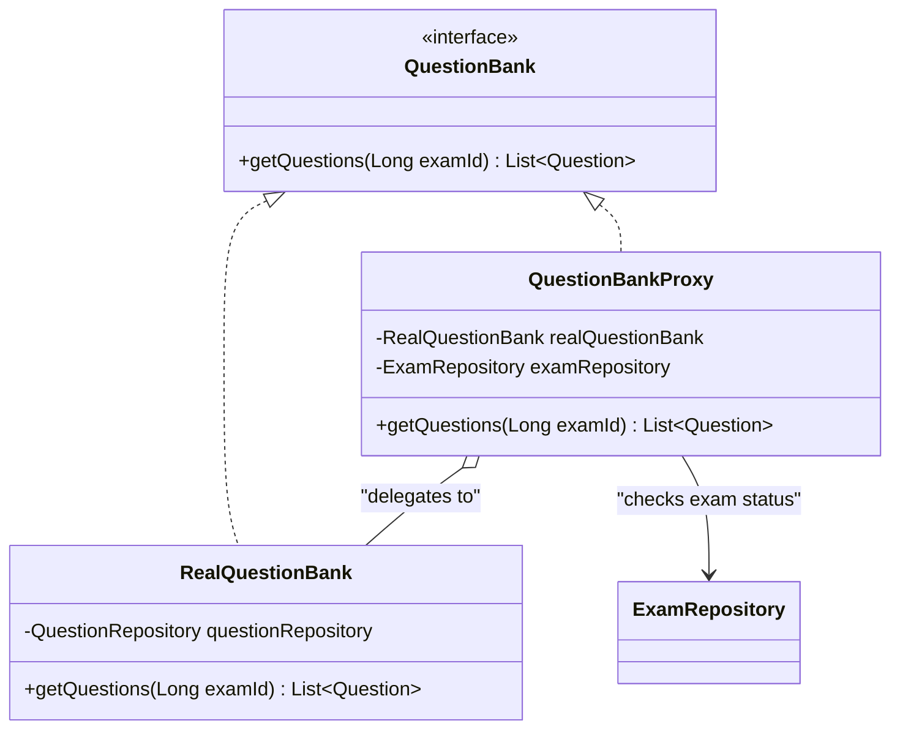

**Participants**:
| Role         | Class               |
| ------------ | ------------------- |
| Subject      | `QuestionBank`      |
| RealSubject  | `RealQuestionBank`  |
| Proxy        | `QuestionBankProxy` |

**Guard Logic**: If `exam.status != "ONGOING"`, returns `Collections.emptyList()` without hitting the DB for questions.

**Where Used**: `QuestionService.getQuestions()`.

---

### 7.6 Bridge — Notification System

> **GoF Category**: Structural
> **Intent**: Decouple notification *sending strategy* (immediate, batched, scheduled) from *delivery channel* (email, SMS, push). Either dimension can vary independently.

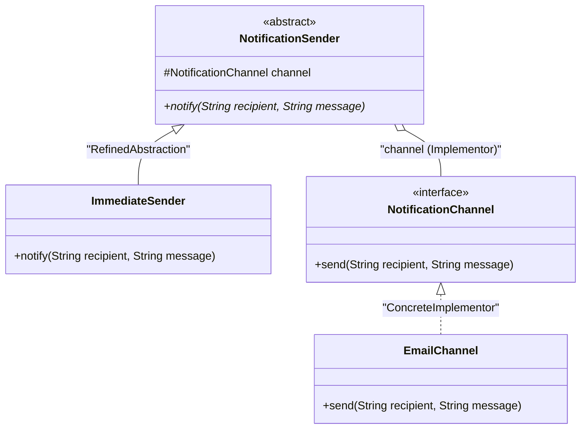

**Participants**:
| Role                  | Class                |
| --------------------- | -------------------- |
| Abstraction           | `NotificationSender` |
| RefinedAbstraction    | `ImmediateSender`    |
| Implementor           | `NotificationChannel`|
| ConcreteImplementor   | `EmailChannel`       |

**Where Used**: `SubmissionService.submit()` — sends a notification to the student after successful submission.

---

## 8. End-to-End Flow — Submission (All 6 Patterns in One Request)

This is the critical flow where all patterns converge:

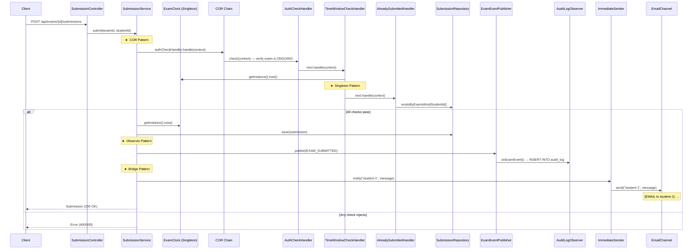

---

## 9. Question Creation Flow (Factory + Proxy)

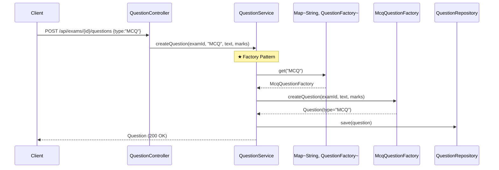

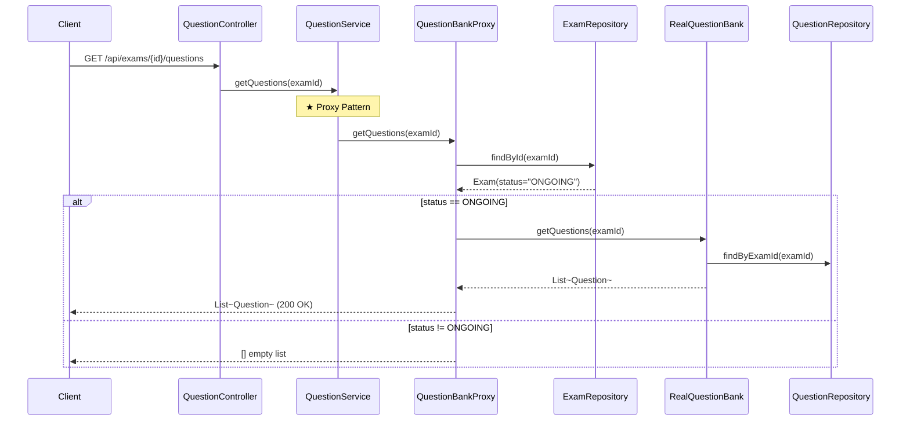

---

## 10. Pattern Integration Summary

| Pattern   | Category    | Triggered By                      | Key Classes                                              |
| --------- | ----------- | --------------------------------- | -------------------------------------------------------- |
| Singleton | Creational  | Any timestamp operation           | `ExamClock`                                              |
| Observer  | Behavioral  | `ExamService.startExam()`, `SubmissionService.submit()` | `ExamEventPublisher`, `ExamEventListener`, `AuditLogObserver`, `ExamEvent` |
| COR       | Behavioral  | `SubmissionService.submit()`      | `SubmissionHandler`, `AuthCheckHandler`, `TimeWindowCheckHandler`, `AlreadySubmittedHandler`, `SubmissionContext` |
| Factory   | Creational  | `QuestionService.createQuestion()`| `QuestionFactory`, `McqQuestionFactory`, `SubjectiveQuestionFactory`, `CodingQuestionFactory` |
| Proxy     | Structural  | `QuestionService.getQuestions()`  | `QuestionBank`, `RealQuestionBank`, `QuestionBankProxy`  |
| Bridge    | Structural  | `SubmissionService.submit()`      | `NotificationSender`, `ImmediateSender`, `NotificationChannel`, `EmailChannel` |

---

## 11. Spring Dependency Injection Wiring

All pattern classes are Spring-managed beans (`@Component` / `@Service`). Key wiring:

- **Factory**: 3 factories registered as `@Component("MCQ")`, `@Component("SUBJECTIVE")`, `@Component("CODING")` → auto-injected as `Map<String, QuestionFactory>` into `QuestionService`
- **Observer**: All `ExamEventListener` beans auto-collected as `List<ExamEventListener>` into `ExamEventPublisher`
- **COR**: Individual handlers injected into `SubmissionService`; chain linked in the constructor: `auth.setNext(timeWindow).setNext(alreadySubmitted)`
- **Bridge**: `EmailChannel` → injected into `ImmediateSender` → injected into `SubmissionService`
- **Proxy**: `RealQuestionBank` + `ExamRepository` → injected into `QuestionBankProxy` → injected into `QuestionService`
- **Singleton**: `ExamClock.getInstance()` — manually managed (not a Spring bean), classic lazy-init with `synchronized`

---

## 12. Technology & Tooling Notes

| Item           | Detail                                                    |
| -------------- | --------------------------------------------------------- |
| JDK            | Temurin 17 (installed via `winget`)                       |
| PostgreSQL     | 16.x (installed via `winget`, binary path added to PATH)  |
| Maven          | Manual install (no winget package available)              |
| IDE/Editor     | Neovim (bare, no LSP configured)                         |
| OS             | Windows 10/11                                            |
| API Testing    | `Invoke-RestMethod` (PowerShell built-in)                |
| No DTO Layer   | Entities returned directly from controllers (lab project) |
| Schema Init    | `schema.sql` auto-executed on startup (`spring.sql.init.mode=always`) |

---

## 13. Known Issues (Resolved)

1. **PostgreSQL `GeneratedKeyHolder` bug** — Postgres JDBC returns all columns on `RETURN_GENERATED_KEYS`, breaking `getKey()`. **Fixed** by specifying `new String[]{"id"}` in all three repositories.
2. **Copy-paste file mixup** — `QuestionRepository.java` temporarily contained `SubmissionRepository` class body. Resolved by re-pasting correct content.

---

## 14. Planned / Incomplete Work

- [ ] Swing/AWT desktop client (Student & Teacher views)
- [ ] Exam `ENDED` status transition
- [ ] Student CRUD endpoint (currently inserted via raw SQL)
- [ ] Grading/scoring logic
- [ ] Additional Observer implementations (beyond `AuditLogObserver`)
- [ ] Additional Bridge channels (SMS, Push — only `EmailChannel` exists)
- [ ] Additional Bridge senders (Batched, Scheduled — only `ImmediateSender` exists)
